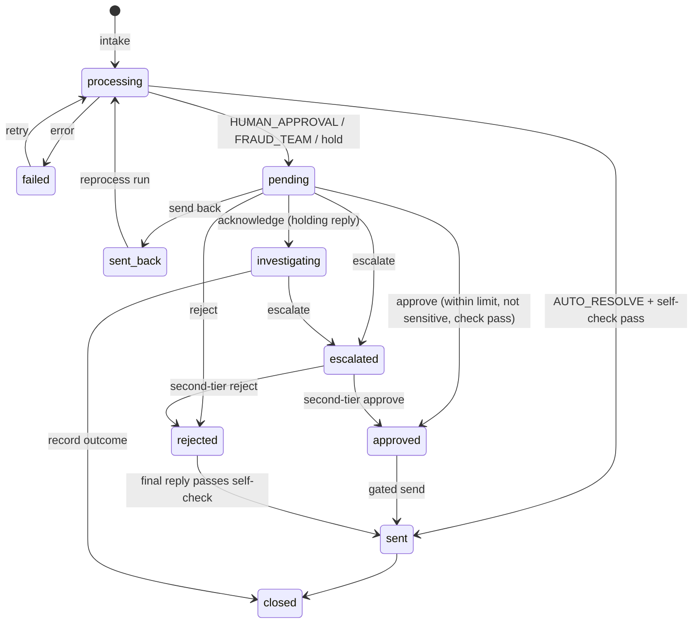

# User Flow: Teratai Complaints Ops Platform

How complaints and people move through the system, from intake to the customer. Reference for the frontend screens.

**Source of truth:** [PLAN.md](PLAN.md) and [backend/contracts.py](../backend/contracts.py). Where this file disagrees with them, they win; fix this file. Briefs: [README.md](../README.md), [bonus_platform.md](bonus_platform.md).

---

## 0. The whole flow at a glance

```
Complaint in  (POST /api/intake, or a CSV dropped in inbox/)
     │
     ▼
Agent: extract (LLM) → match + decide (code) → draft (LLM) → self-check (code) → route/hold (code)
     │
     ├─ AUTO_RESOLVE ──────────────► self-check pass → simulated send (authorised_by "auto") → sent → closed
     │
     ├─ HUMAN_APPROVAL → Officer
     │     ├─ within limit, not sensitive ──► approve → sent
     │     └─ over limit or sensitive ──────► escalate → Manager → second-tier approve/reject
     │
     └─ FRAUD_TEAM → Fraud analyst
           ├─ acknowledge (releases holding reply) → investigate → record outcome → closed
           └─ high value or sensitive ─────► escalate → Manager
```

- The agent never routes to the manager. Only a first-tier user escalates.
- **Holds only push toward humans.** Any `hold_reason` on a non-INVESTIGATE case changes `route` to `HUMAN_APPROVAL`, with the reason shown in the queue. INVESTIGATE always stays `FRAUD_TEAM`. `decision.policy_route` keeps the route before the hold.
- Refunds and messages are **simulated**. The backend enforces the gate and writes an outbound record, and the UI labels it "Simulated".

---

## 1. Actors

| Actor | Sees | Can do | Approval limit |
|---|---|---|---|
| **Agent pipeline** | Every complaint | Produces one immutable run per execution | n/a |
| **Complaints Officer** (`officer1`) | `HUMAN_APPROVAL` queue | Approve / edit reply then approve / reject / send back / escalate / flag sensitive | RM 5,000, measured on the **refund amount** |
| **Fraud Analyst** (`fraud1`) | `FRAUD_TEAM` queue | Acknowledge / log investigation or recall / record outcome / escalate / flag sensitive | RM 5,000, measured on the **disputed transaction amount** |
| **Manager** (`manager1`) | Both queues, escalation queue, all cases (AUTO_RESOLVE read-only), audit log, metrics | Everything the first tier can do, plus second-tier approve/reject and reassign | No limit |

**Sensitive** forces escalation regardless of amount. A case is sensitive when the customer is vulnerable (65+ on `received_at`, from `decision.vulnerable`), or when a first-tier user flags it with a reason (`POST /flag-sensitive`).

Role checks are enforced **in the backend** on every case and action endpoint. Hiding links in the UI is not enough.

---

## 2. Flow A: Intake and agent processing (system)

**Triggers:**
1. `POST /api/intake`: one complaint row (same fields as the live round) or a CSV
2. A CSV dropped into the watched folder `inbox/`: same intake path
3. The Intake screen: a form, or paste one CSV row. It calls `POST /api/intake`

```
complaint_id,customer_id,received_at,channel,subject,text
LIVE-07,CUS-01234,2026-09-30 10:15,App chat,,"Hi, I was charged twice at ShopLah Online today for RM89.90..."
```

`received_at` is accepted as `YYYY-MM-DD HH:MM[:SS]`, `DD-MM-YYYY HH:MM[:SS]` or `DD/MM/YYYY HH:MM[:SS]`, in Malaysia time.

**Intake rules:**

| Situation | Result |
|---|---|
| New complaint | Case persisted first (`processing`), pipeline runs in the background, response returns the case ID for polling |
| Same complaint ID, identical content | Returns the existing case (no duplicate) |
| Same complaint ID, different content | Rejected |
| Unknown `customer_id` | Accepted and stored, never dropped: no transaction lookup, held `customer_not_found` (HUMAN_APPROVAL, or FRAUD_TEAM if INVESTIGATE) |
| Pipeline or delivery failure | Visible `failed` state, with retry |

**Pipeline steps** (`backend/agent/pipeline.py`):

| # | Step | By | Stored on the run |
|---|---|---|---|
| 1 | Extract | LLM | `clues`, `extract_usage` |
| 2 | Match and decide | Code (category handler) | `match` (status, candidates, final category), `decision` (outcome, refund, priority, language, route, `rule_id`, `calculation`, hold, SLA), `evidence` |
| 3 | Draft | LLM | `reply_text`, `draft_usage[]` |
| 4 | Self-check | Code | `self_check`; on fail, one redraft (`redraft_count`), then hold `self_check_failed` |
| 5 | Route and store | Code | Case moves to its queue |

**Where the case ends up:**

| Decision | Status | Queue | Customer receives |
|---|---|---|---|
| AUTO_RESOLVE, self-check pass | `sent` → `closed` | none (manager sees it read-only) | Reply, simulated, `authorised_by = auto` |
| HUMAN_APPROVAL (DECLINE, refund > RM 500, or any hold) | `pending` | Officer | Nothing yet |
| FRAUD_TEAM (INVESTIGATE) | `pending` | Fraud analyst | Nothing until acknowledged |
| Pipeline error | `failed` | visible to the manager, with retry | Nothing |

**Hold reasons** (`HoldReason`), shown as the queue reason:

| `hold_reason` | Queue label |
|---|---|
| `customer_not_found` | Unknown customer |
| `ambiguous_match` | Ambiguous match |
| `no_match` | No matching transaction |
| `category_revised` | Category revised |
| `self_check_failed` | Self-check failed |
| `unknown_auth_method` | Unknown auth method |
| `llm_error` | LLM error |

**SLA:** `ack_due_at = received_at + acknowledge hours`; `resolve_due_at = received_at + resolve business days` (Mon–Fri, no holidays). Targets: P1 2 h / 3 days, P2 24 h / 7 days, P3 48 h / 14 days. The UI measures against a **labelled demo clock (2026-09-30)** so historical data isn't all overdue.

---

## 3. Flow B: Live round

1. The judge gives 2–3 complaints. Paste one into the Intake form or drop the CSV into `inbox/`.
2. The intake returns the case ID, and the UI polls it: `processing` → final status.
3. Open the case: evidence, calculation, route, checked reply.
4. HUMAN_APPROVAL cases wait in the officer queue; FRAUD_TEAM cases wait in the fraud queue.
5. Show the self-check blocking an edited reply with an invented amount.

---

## 4. Flow C: Complaints Officer (HUMAN_APPROVAL)

**Queue:** sorted by priority, then SLA due. Each row shows why it is waiting: "Refund > RM500", "Decline needs approval", "Ambiguous match", "Self-check failed", or another hold label.

**Case view leads with:** the drafted `reply_text` (editable), the decision, the refund and calculation, an evidence panel (matched transaction, other candidates, verification status), the self-check badge, and the approval headroom ("Your limit: RM5,000. This refund: RM550. ✓").

| Action | Endpoint | Rules |
|---|---|---|
| **Approve** | `POST /approve` | Blocked if the refund is over the officer's limit or the case is sensitive (must escalate). Requires the current reply's self-check = pass. Status → `approved`, then the gated send → `sent` |
| **Edit reply** | `POST /edit-reply` | **Re-runs the self-check**, logs the diff, and **clears any prior approval** |
| **Reject** | `POST /reject` | Reason required. The officer sets the final outcome and a reply that must pass the self-check before anything is sent |
| **Send back** | `POST /send-back` | Creates a new `reprocess` run; the autonomous run is untouched. Status `sent_back` → `processing` → back to a queue |
| **Escalate** | `POST /escalate` | Reason required. Status → `escalated`; the case waits for the manager. Over limit or sensitive: Approve is replaced by **"Escalate to Manager"** |
| **Flag sensitive** | `POST /flag-sensitive` | Reason required. Forces escalation |

After an action: auto-advance to the next case. Delivery is shown from the outbound record, labelled "Simulated".

---

## 5. Flow D: Fraud Analyst (FRAUD_TEAM)

Long-lived cases. The customer gets only the holding reply, and only after acknowledgement.

**Workbench leads with:** the suspicious transaction and its `auth_method` (3DS-OTP / Chip+PIN / None: the deciding fact), related transactions on the same account, and the case timeline.

| Step | Endpoint | Effect |
|---|---|---|
| 1. **Acknowledge** | `POST /acknowledge` | **Releases the holding reply** to outbound. Status → `investigating` |
| 2. **Log investigation / recall** | `POST /investigate` | Appends to the timeline |
| 3. **Record outcome** | `POST /record-outcome` | Confirmed fraud / not fraud / recall succeeded / recall failed. Status → `closed` |
| **Escalate** | `POST /escalate` | Sensitive or high-value (disputed amount over the analyst's limit) → manager |

---

## 6. Flow E: Manager

- **Metrics tiles** (`GET /api/metrics`): throughput, auto-resolve rate, SLA compliance, override rate, self-check catches, cost and latency per complaint.
- **Escalation queue:** merged from both teams. Shows what the first tier did and why it was escalated. **Second-tier approve / reject** with a reason (`POST /second-tier-approve`, `/second-tier-reject`).
- **All cases table:** filter by queue, category, priority, status and officer; **reassign** (`POST /reassign`). AUTO_RESOLVE cases are read-only.
- **Audit log** (`GET /api/audit`): append-only, expandable rows, diffs for edits, export.
- **Agent vs human:** the autonomous run beside the final action for every overridden case.

---

## 7. The gated send

Every human-gated send goes through one backend function that checks:
1. the right role
2. approved, and second-tier approved if the case was escalated
3. the current reply passed the self-check
4. not already sent

It protects against double clicks and retries. The UI disables buttons while a request is in flight and never sends from the client.

---

## 8. Case status reference (`cases.status`)

| Status | Meaning | Customer has received |
|---|---|---|
| `processing` | Pipeline running (new intake or after send-back) | Nothing |
| `failed` | Pipeline or delivery failed; retry available | Nothing |
| `pending` | Waiting in the officer or fraud queue | Nothing |
| `escalated` | Waiting for the manager | Nothing (fraud: holding reply if already acknowledged) |
| `approved` | Approved, waiting for the gated send | Nothing |
| `rejected` | Rejected; final outcome and reply set by the officer | Nothing until the reply passes the self-check and is sent |
| `sent_back` | Returned to the agent for a reprocess run | Nothing |
| `investigating` | Fraud case acknowledged | Holding reply |
| `sent` | Resolution sent (simulated) | Final reply |
| `closed` | Done (auto-resolved after send, or fraud outcome recorded) | Final reply / holding reply + outcome |



---

## 9. Audit actions (`case_events.action`)

`ingest`, `agent_run`, `approve`, `edit`, `reject`, `send_back`, `escalate`, `reassign`, `acknowledge`, `investigate`, `record_outcome`, `second_tier_approve`, `second_tier_reject`, `send`.

A reason is required on every action that changes the agent's decision. Edits store old → new and the self-check result.

---

## 10. Integrity

- `agent_runs` rows never change. Human actions change `cases` and append `case_events`.
- `predictions.csv` is exported from `cases.autonomous_run_id` only: never from human-corrected fields or reprocess runs.
- The gap between the autonomous run and the final action is shown to the manager.

---

## 11. Demo script (PLAN.md)

1. **Show the system (1 min):** architecture (LLM does language, code does money), three role logins.
2. **Live round (3 min):** paste a judge's CSV row (or drop it in `inbox/`), watch it process, and show the case in the right queue with evidence, calculation and checked reply.
3. **Three cases end to end (3 min):**
   - **A:** HUMAN_APPROVAL refund RM550 (within the RM5,000 limit) → officer approves → "sent (simulated)"
   - **B:** HUMAN_APPROVAL refund over the limit → officer escalates → manager second-tier approves → "sent (simulated)"
   - **C:** FRAUD_TEAM → analyst acknowledges (holding reply released) → logs investigation → customer sees only the holding reply
4. **Observability (1 min):** audit log with edit diffs, agent-vs-human gap, self-check blocking an invented amount, metrics (override rate, cost and latency).

> **Data note for Case B:** PLAN.md uses a RM6,000 refund, but the largest refund in `labels_train.csv` is RM4,687.10, so no real case exceeds RM5,000. Raise with the team before rehearsal.

---

## 12. Out of scope (PLAN.md)

Real money movement, real customer messaging, production identity, cloud deployment, vector DBs, **policy-editing UI**.
