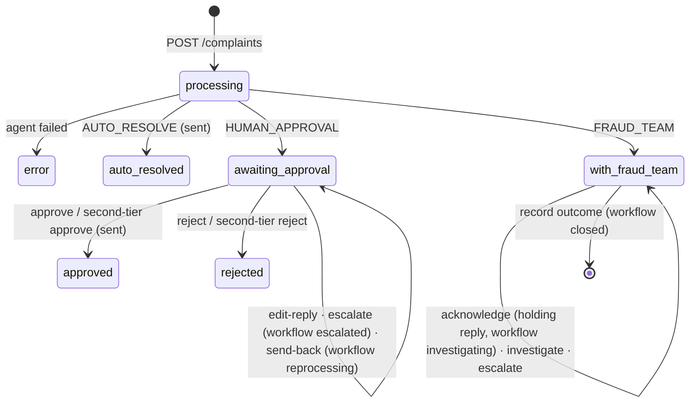

# User Flow: Teratai Complaints Ops Platform

How complaints and people move through the system, from intake to the customer. Reference for the frontend screens.

**Source of truth:** [api.md](api.md) (the organisers' contract), [UI_API.md](UI_API.md) (the UI's backend API: fields, actions, errors) and [PLAN.md](PLAN.md). Where this file disagrees with them, they win; fix this file. Briefs: [README.md](../README.md), [bonus_platform.md](bonus_platform.md).

---

## 0. The whole flow at a glance

```
POST /complaints  (judges' live round, api_check.py, or a rehearsal)
     │
     ▼
Agent: extract (LLM) → match + decide (code) → draft (LLM) → self-check (code) → route/hold (code)
     │                                                         (queue: processing, then ↓)
     ├─ AUTO_RESOLVE ─────────► queue auto_resolved · reply sent automatically (simulated outbox)
     │
     ├─ HUMAN_APPROVAL ───────► queue awaiting_approval · nothing sent yet
     │     ├─ officer approves (within limit, not sensitive) ─► approved · sent
     │     ├─ officer rejects ───────────────────────────────► rejected · nothing sent
     │     └─ over limit or sensitive ─► escalate ─► Manager: second-tier approve / reject
     │
     └─ FRAUD_TEAM ───────────► queue with_fraud_team · nothing sent yet
           ├─ analyst acknowledges ─► holding reply sent · workflow investigating
           ├─ investigate (any number of times) → record outcome ─► workflow closed
           └─ disputed amount over limit or sensitive ─► escalate ─► Manager decides
```

- The agent never routes to the manager. Only a first-tier user escalates.
- **Holds only push toward humans:** a `hold_reason` moves a non-fraud case to `HUMAN_APPROVAL`; fraud stays `FRAUD_TEAM`. `decision.policy_route` keeps the route before the hold.
- Refunds and messages are **simulated**: an outbox record, labelled "Simulated" in the UI.
- The agent's own decision never changes (`autonomous`); what people did is stored next to it (`final`, `differs`).

---

## 1. Actors

| User | Name | Role | Sees | Approval limit |
|---|---|---|---|---|
| `officer1` | Aina Rahman | officer | approval cases | RM2,000, on the **refund** |
| `officer2` | Daniel Lim | officer | approval cases | RM2,000 |
| `fraud1` | Farid Hassan | fraud | fraud cases | RM5,000, on the **disputed transaction** |
| `manager1` | Mei Ling Tan | manager | everything, plus metrics, audit and users | none |

All demo users use the password `teratai123`.

- **Sensitive** forces escalation regardless of amount: the customer is 65+ (always), or someone flagged it (`flag-sensitive`, with a reason).
- Auto-resolved, processing and error cases belong to no team: only the manager sees them.
- Role checks run **in the backend**. Another team's case returns 404; metrics, audit and users return 403 for first-tier users. The UI only hides.

---

## 2. The case model (UI_API.md)

A case has three independent facts. Show all three.

| Field | Values | Meaning |
|---|---|---|
| `status` | `processing`, `done`, `error` | Is the agent finished? |
| `queue` | `processing`, `error`, `auto_resolved`, `awaiting_approval`, `with_fraud_team`, `approved`, `rejected` | Where the case is (the contract's `case_state`, plus processing/error). Drives the queue tabs |
| `workflow` | `null`, `escalated`, `reprocessing`, `investigating`, `closed` | Ops-platform state on top of the queue |
| `sent` | `true` / `false` | Has a reply reached the customer (outbox)? |

| `queue` | `sent` | Who acts |
|---|---|---|
| `auto_resolved` | true | nobody (manager sees it for audit) |
| `awaiting_approval` | false | officer |
| `with_fraud_team` | false, then true after acknowledge (holding reply) | fraud analyst |
| `approved` | true | done |
| `rejected` | false | done; the officer handles the case outside the agent |

`waiting_reason` (from the backend) is the queue row's "why it's waiting" line: "Refund over RM500", "Decline needs approval", "Ambiguous match", "Fraud investigation", "Escalated to the manager", "Agent is working on it". It is `null` for closed cases.

---

## 3. Flow A: a complaint arrives (system)

1. `POST /complaints` with the six fields of a `complaints.csv` row. Any client: the organisers' laptop, `api_check.py`, a rehearsal script, or the optional intake form.
2. The case appears at once with `queue: processing`, and moves to its queue a few seconds later.
3. **The UI must show it on its own:** poll the list every 3–5 s (`sort=recent` puts new cases first), and poll a case page every 2 s while it is `processing` or `reprocessing`.

Intake rules are the backend's: the same complaint posted twice returns the existing case; an unknown customer is accepted and held (`customer_not_found`); a failed run shows `status: error` with the reason.

---

## 4. Flow B: the live round (README)

**Hidden test (15 points, no UI):** at 15:00 the organisers' script posts 20 messy complaints to our API and scores the answers.

**Human gate (10 points, through the UI)**: in the demo, judges post 3 complaints one at a time and tick, for each:
- the case **appears on its own**
- the right transaction, decision and refund
- the right route
- a case needing approval **waits until someone approves it** in the UI (and the API shows `awaiting_approval`, `sent: false` until then)
- a fraud case lands in the **fraud queue**
- the reply is in the right language and matches the decision
- the **self-check result is visible**

---

## 5. Flow C: complaints officer (`awaiting_approval`)

**Queue:** approval cases, priority first, then the earliest due date. Each row shows `waiting_reason`.

**Case page leads with** the reply (editable, with the self-check badge), then the decision, refund and calculation, then the evidence. The approval headroom is shown: "Your limit: RM2,000. This refund: RM550. ✓".

| Button | Action (`POST /api/cases/{id}/<action>`) | Rule |
|---|---|---|
| **Approve** | `approve` `{reason?}` | Sends the reply (the edited draft if any) and the refund. Not allowed over the limit or when sensitive: show **Escalate to manager** instead. Locked while an edited draft is flagged |
| **Edit reply** | `edit-reply` `{reply_text, reason}` | Saves `draft_reply` with its self-check result, even when it fails. Show the problems next to the text |
| **Reject** | `reject` `{reason}` | Rejected; nothing is sent |
| **Send back** | `send-back` `{note}` | **202**; the agent re-runs with the note (`workflow: reprocessing`). Poll until `workflow` is null; the case gets a second run and always waits for a person |
| **Escalate** | `escalate` `{reason}` | `workflow: escalated`; waits for the manager |
| **Flag sensitive** | `flag-sensitive` `{reason}` | The case now needs the manager |

After an action, redraw the page from the returned case detail.

---

## 6. Flow D: fraud analyst (`with_fraud_team`)

**Workbench leads with** the suspicious transaction and its `auth_method` (3DS-OTP / Chip+PIN / None), related transactions, and the timeline from `events`. The customer gets only the holding reply.

| Step | Action | Effect |
|---|---|---|
| 1. **Acknowledge** | `acknowledge` `{reason?}` | Sends the holding reply; `workflow: investigating` |
| 2. **Log** | `investigate` `{note, kind}` (`investigation` or `recall_attempt`) | Adds a timeline entry; any number of times |
| 3. **Record outcome** | `record-outcome` `{outcome, reason}` | `confirmed_fraud` / `not_fraud` / `recall_succeeded` / `recall_failed`; `workflow: closed`; no message to the customer |
| **Escalate** | `escalate` `{reason, outcome}` | When the disputed transaction is over RM5,000 or the case is sensitive; the manager approves the proposed outcome |

---

## 7. Flow E: manager

- **Escalation queue** (`workflow=escalated`, both teams). Each case carries `escalation`: who, when, why, and the proposal (the reply to send, or the fraud outcome). **Second-tier approve / reject** with a reason. A fraud reject returns the case to investigating.
- **All cases**, with **reassign** (`reassign` `{username, reason?}`; users from `GET /api/users`). Once assigned, only that person or the manager can act.
- **Dashboard** (`GET /api/metrics?as_of=<demo clock>`): auto-resolve rate, open/overdue/due-soon, self-check catches, override rate, cost and latency per complaint, SLA compliance, turnaround, refunds, charts.
- **Audit log** (`GET /api/audit`): who did what, filterable by actor, action and dates.
- **Agent vs human** (`overridden=true`): `autonomous` beside `final`, with `differs`.

---

## 8. State diagram



---

## 9. Without logging in (core contract)

The organisers' contract routes ([api.md](api.md)) need no login: `POST /cases/{id}/actions` (`approve`, `edit_approve`, `reject`, with a typed `actor`) and `POST /cases/{id}/acknowledge`. They refuse (409) a case that is escalated, re-running or closed on the platform, so the two-tier rule can't be bypassed. Our UI signs in and uses the platform actions above; the contract routes remain the judges' and `api_check.py`'s path.

---

## 10. Demo flows (PLAN.md, bonus)

1. **Within the limit:** an officer approves a refund under RM2,000 (or edits it, triggering the self-check) → sent (simulated).
2. **Over the limit:** a refund over RM2,000 → the officer sees "Escalate to manager" → the manager second-tier approves → sent.
3. **Fraud:** the analyst acknowledges (holding reply sent) → logs an investigation or recall attempt → records the outcome.

Then show the audit log, agent vs human, and an edited reply with an invented amount being refused.

**Out of scope (PLAN.md):** real money movement, real customer messaging, production identity, policy editing, WebSocket push, the chatbot panel, notifications.
